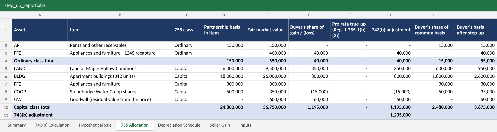
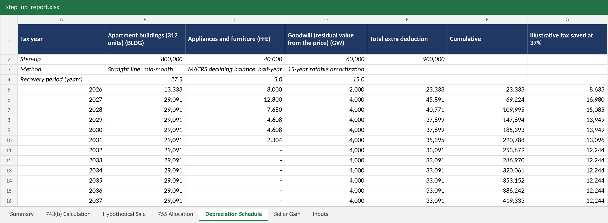

# Section 754 Step-Up Calculator

**A Python tool that works out the tax "step-up" a buyer gets when they buy into a partnership, splits it across the partnership's assets, and builds the buyer's extra depreciation schedule, all exported to a formatted Excel workbook.**

Built by an Enrolled Agent and corporate tax analyst who works on complex partnerships. It is a companion to my [Partnership Basis Tracker](https://github.com/angiem34772-web/partnership-basis-tracker).

> All data in this repository is made up. The partnership, partners, and amounts are fictional.



---

## In plain English

When someone buys an interest in a partnership from an existing partner, they usually pay today's market value. But the partnership's own tax records (its "inside basis" in the buildings, equipment, and so on) still reflect the old, lower numbers. Without a fix, the buyer would effectively pay tax on gains that built up before they arrived.

The fix is a **Section 754 election**. When it is in effect, the buyer gets a personal **Section 743(b) adjustment**, a "step-up" that brings their share of the assets' tax basis up to what they paid. The step-up then has to be **split across the partnership's assets** under Section 755, and the part assigned to buildings, equipment, and goodwill is **depreciated or amortized**, which gives the buyer extra deductions for years.

Doing this by hand means a hypothetical sale of every asset, two classes of property, recapture carve-outs, and three different depreciation methods. This project automates it:

1. **Reads** the partnership's tax balance sheet and the sale terms from two CSV files.
2. **Computes the 743(b) adjustment**: the buyer's cost basis minus their share of the partnership's inside basis.
3. **Values goodwill** from the purchase price (residual method).
4. **Allocates the adjustment** between ordinary income property and capital gain property, then asset by asset, following Reg. 1.755-1.
5. **Builds the depreciation schedule** for the step-up, which starts a fresh recovery period on the sale date.
6. **Shows the seller's side**: total gain and how much is ordinary income, 25% gain, and 20% gain.
7. **Flags** what a reviewer should catch: a missing election, a mandatory adjustment, a Form 8308 filing.

## Skills shown

| Area | What this project shows |
|---|---|
| Partnership tax | IRC 743(b), 754, 755, 742, 752(d), 751(a), 743(d), 197, 168 (MACRS), Reg. 1.1(h)-1 look-through |
| Python | Small package, dataclasses, a command line interface, one dependency (openpyxl) |
| Testing | 20 pytest tests: the sample sale checked line by line against a [hand calculation](docs/hand_calculation.md), and depreciation checked against IRS Pub. 946 tables |
| Excel | A 7-tab report a reviewer can audit, with each step tied to its regulation |

## The sample sale

This continues the story of **Maple Hollow Partners LP**, the fictional real estate partnership from the [Partnership Basis Tracker](https://github.com/angiem34772-web/partnership-basis-tracker) (the balance sheet here is a standalone example and doesn't tie to that project's numbers).

On **July 1, 2026**, seed investor **Alder Creek Family Trust** sells a **10% interest** to a new investor, **Juniper Ridge Holdings LLC**, for **$1,850,000 cash**. The partnership owns land, a 312-unit apartment community, furniture and appliances, and some water co-op shares, with a $20 million mortgage. It has a 754 election in effect.

| | Amount |
|---|---:|
| Buyer's outside basis: $1,850,000 cash + $2,000,000 share of the mortgage | 3,850,000 |
| Buyer's share of the partnership's inside basis | 2,615,000 |
| **743(b) step-up** | **1,235,000** |

Where the step-up goes, and what it is worth to the buyer:

| Asset | Step-up | How it's recovered | Extra deduction in 2026 |
|---|---:|---|---:|
| Apartment buildings | 800,000 | 27.5-year straight line | 13,333 |
| Furniture and appliances (depreciation recapture) | 40,000 | 5-year MACRS | 8,000 |
| Goodwill (valued from the price) | 60,000 | 15-year amortization | 2,000 |
| Land | 350,000 | Not depreciable; lowers the buyer's gain on a future sale | |
| Water co-op shares | (15,000) | Not depreciable; a step-down, because they've lost value | |
| **Total** | **1,235,000** | | **23,333** |

Over the first 10 years that is **$353,152 of extra deductions** for the buyer, about **$130,666 of tax** at a 37% rate.

On the other side, the seller has a **$1,150,000 gain**: $40,000 is ordinary income (furniture recapture, under Section 751), $800,000 is unrecaptured Section 1250 gain taxed at up to 25%, and $310,000 is regular long-term capital gain.

Every one of these numbers is worked by hand in [docs/hand_calculation.md](docs/hand_calculation.md) and checked by the tests.



## The Excel report

Running the tool creates [`output/step_up_report.xlsx`](output/step_up_report.xlsx):

| Tab | What it shows |
|---|---|
| Summary | The deal, the step-up, the buyer's extra deductions, and any flags |
| 743(b) Calculation | The adjustment step by step, with the regulation behind each line |
| Hypothetical Sale | Each asset "sold" at market value, and the buyer's share of the gain or loss |
| 755 Allocation | The split between ordinary and capital property, then by asset |
| Depreciation Schedule | The buyer's extra deductions, year by year, until fully recovered |
| Seller Gain | The seller's gain and its character |
| Inputs | The balance sheet and sale terms used |

## How to run it

You need Python 3.10 or newer.

```bash
git clone https://github.com/angiem34772-web/section-754-step-up-calculator.git
cd section-754-step-up-calculator
pip install -r requirements.txt

python -m step_up          # prints the result and builds output/step_up_report.xlsx
python -m pytest           # runs the tests
```

To try your own numbers, copy [`sample_data/`](sample_data/) to a new folder, edit the two CSV files, and run:

```bash
python -m step_up --data my_folder --out my_report.xlsx
```

**`assets.csv`**: one row per asset, with `asset_type` set to one of `cash`, `receivable`, `inventory`, `land`, `residential_building`, `nonresidential_building`, `personal_property`, `capital_asset`, or `section_197`. `prior_depreciation` drives the recapture and Section 1250 tests; `recovery_years` sets the MACRS life for a step-up; `remaining_years` is used for a step-down.

**`sale.csv`**: the partnership, seller, buyer, date, `interest_sold` (0.10 for 10%), cash price, total partnership debt, the buyer's debt share, the seller's outside basis, whether a 754 election is in effect, a bonus depreciation percentage, and a tax rate for the illustration.

## Tax rules implemented

For reviewers with a tax background, here is what the engine does ([`adjustment.py`](step_up/adjustment.py), [`depreciation.py`](step_up/depreciation.py)).

**The adjustment (IRC 743(b), Reg. 1.743-1)**
- Buyer's outside basis is cash paid plus the buyer's share of partnership liabilities (IRC 742, 1012, 752(d)).
- Share of inside basis is previously taxed capital plus share of liabilities, where previously taxed capital comes from a hypothetical sale of all assets at fair market value (Reg. 1.743-1(d)).
- The adjustment applies if a 754 election is in effect, or if it is mandatory because of a substantial built-in loss over $250,000 at the partnership or buyer level (IRC 743(d)).

**The allocation (IRC 755, Reg. 1.755-1)**
- Partnership gross value comes from the price; any excess over the listed assets is goodwill (Reg. 1.755-1(a)(4), (a)(5)).
- Section 1245 recapture is split out as a separate ordinary income item (Reg. 1.755-1(a)(1)).
- The ordinary income class gets the buyer's share of ordinary income from the hypothetical sale, and the capital gain class gets the rest (Reg. 1.755-1(b)(2)). A decrease to capital gain property that exceeds its basis moves to ordinary income property.
- Within each class, each item gets the buyer's share of its gain or loss, adjusted pro rata by value for any difference (Reg. 1.755-1(b)(3)). No item can go below zero basis; the excess moves to the other items in the class.

**Recovery (Reg. 1.743-1(j)(4))**
- A step-up on depreciable property is treated as new property placed in service on the sale date: residential and nonresidential buildings use straight line with the mid-month convention, personal property uses MACRS 200% (or 150%) declining balance with the half-year convention, and Section 197 intangibles amortize monthly over 15 years.
- Optional bonus depreciation on the personal property step-up (`bonus_pct`).
- A step-down on depreciable property is spread evenly over its remaining recovery period.

**The seller (IRC 741, 751(a), Reg. 1.1(h)-1)**
- Gain is amount realized (cash plus debt relief) minus the seller's outside basis.
- The seller's share of hot-asset income is ordinary; the building gain, up to depreciation taken, is unrecaptured Section 1250 gain; the rest is long-term capital gain.

## Assumptions and limits

This is a portfolio project, kept small on purpose. A production version would also need:

- Special allocations and Section 704(c) built-in gain, which change each partner's share in the hypothetical sale (this version uses ownership percentage for everything)
- Section 734(b) adjustments for distributions and redemptions, and substituted basis transfers such as gifts and inheritances (Reg. 1.755-1(b)(5))
- The mid-quarter convention test (the tool flags a 4th-quarter sale but assumes half-year)
- Section 197 anti-churning rules and other intangibles valued separately from goodwill
- Section 1250 "additional depreciation" for property depreciated faster than straight line
- State conformity, and partnership reporting of the adjustment on Schedule K-1

## Project structure

```
step_up/
  models.py           data structures for assets, the sale, and results
  loader.py           reads and validates the CSV inputs
  adjustment.py       the 743(b) adjustment, 755 allocation, and seller's gain
  depreciation.py     MACRS, mid-month straight line, and Section 197 amortization
  excel_export.py     the formatted Excel report
  __main__.py         command line entry point
sample_data/          fictional balance sheet and sale terms
docs/                 hand calculation and screenshots
tests/                pytest tests
output/               the generated Excel report
```

## About me

I'm an Enrolled Agent (EA) and corporate tax analyst specializing in complex partnerships. I'm interested in roles where tax expertise meets automation and data.

Connect with me on [LinkedIn](https://www.linkedin.com/in/angie-jenkins-ea).
